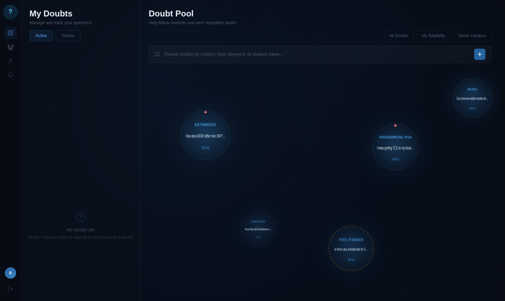

# Studn't — Peer Doubt Resolution Platform

> **Help that floats to the right people.**  
> Post a doubt, get matched by skill, and help others in return. No more shouting into the void — your question finds the one person who knows.

[](#tech-stack)
[](#tech-stack)
[](#)

---

## Screenshots

### Landing Page


### Dashboard — Live Doubt Pool

> Doubts float as bubbles — bigger means higher urgency, brighter glow means stronger skill match with you.

### Post a Doubt


### Notifications


### Profile


### Leaderboard


### Sign Up


### Login


---

## The Problem

Students have no structured peer channel for getting help:

| Channel | Problem |
|---|---|
| WhatsApp / Telegram | Doubts drown in noisy group chats. No structure, no tracking. |
| Stack Overflow / Quora | Generic answers — not your professor, not your syllabus. |
| Office Hours | Fixed slots, long queues — urgency and availability never align. |

**Studn't** solves this with skill-based matching, urgency ranking, and a reputation system that rewards consistent helpers.

---

## Features

- **Live Bubble Pool** — Open doubts render as physics bubbles on a canvas. Bubble size = urgency. Glow intensity = how well the doubt matches your skills.
- **Skill-Based Matching** — Declare your academic and non-academic skills at signup. Only relevant doubts are shown to you (≥ 60% match threshold).
- **Post a Doubt** — Set urgency (0–100 slider), add subject tags, and optionally specify a course + professor for exam-related doubts.
- **Claim & Answer** — Claim any doubt you can help with. Reply through a threaded answer system. The person who posted decides when it's resolved.
- **My Doubts Panel** — Three tabs: Active (doubts you posted), Claimed (doubts you're answering), Solved (resolved history).
- **Reputation System** — Decay-weighted score. Recent ratings move it meaningfully but one bad rating won't tank you. New users start at 50/100 — no cold-start penalty.
- **Leaderboard** — Daily / monthly / all-time rankings by reputation and contributions.
- **Notifications** — Real-time alerts for claims, replies, and resolutions.
- **Profile** — Skill rings, reputation level, badges, activity feed, and a terminal-style details panel.

---

## How It Works

```
Sign Up → declare skills (academic + non-academic)
    ↓
Dashboard → see open doubts as bubbles, ranked by urgency × match strength
    ↓
Click a bubble → read the full doubt, claim it if you can help
    ↓
Reply with your answer → doubt author marks it resolved
    ↓
Both parties rate each other → reputation updates
```

---

## The Algorithms

All three are **pure functions** — no DOM refs, no side effects. Paste into a Node REPL to test.

### `matchScore(doubt, user)` → `0..1`
Measures how well a doubt fits a user's declared skills.
- **Academic doubts** — tag overlap between doubt's subject tags and user's `academicSkills`.
- **Exam/logistics doubts with a `courseContext`** — exact `course + professor` string match scores significantly higher than a category-only match, because lived experience with that specific class is what actually helps.

### `priorityScore(doubt, candidateUsers, now)` → `number`
Ranks doubts in the pool. Combines:
- `w1 × helperAvailabilityWeight` — how many eligible helpers exist right now
- `w2 × matchStrength` — average match score across eligible helpers
- `w3 × waitTimeMinutes` — doubts waiting longer get a ranking boost

Tie-break: earlier `createdAt` wins on identical scores.

### `reputationScore(previousRep, recentRatings, decayFactor = 0.7)` → `number`
```
newRep = decayFactor × previousRep + (1 − decayFactor) × avgOfRecentRatings
```
- Decay factor `0.7` means recent ratings move the score meaningfully without whiplash.
- Seeds at `50` (neutral midpoint) — new users are never penalised just for being new.

---

## Tech Stack

| Layer | Tech |
|---|---|
| UI | Vanilla HTML / CSS / JavaScript (ES6 modules) |
| Data | `localStorage` only — no server, no database |
| Canvas | `<canvas>` API — bubble physics + background animations |
| Routing | Multi-page HTML — no SPA framework |
| Build | None — open `index.html` directly |

**Dependency rule:** `store.js` is the only file that touches `localStorage`. Every other module reads/writes through it. This makes the Phase 2 migration a one-file change.

---

## File Structure

```
/
├── index.html             Landing page
├── signup.html            Multi-step skill questionnaire
├── login.html             User picker (Phase 1 — no real auth yet)
├── dashboard.html         Main app — bubble pool + my doubts
├── profile.html           Own profile + public view (?id=xxx)
├── leaderboard.html       Reputation rankings
│
├── css/
│   ├── tokens.css         Design system tokens
│   ├── base.css           Resets + typography
│   ├── components.css     Buttons, cards, toasts
│   └── pages/             Page-specific styles
│
└── js/
    ├── store.js            LocalStorage abstraction (ONLY file that calls localStorage.*)
    ├── models.js           User/Doubt factory functions + validation
    ├── categories.js       Fixed category taxonomy — single source of truth
    ├── bubbles.js          Canvas bubble physics + rendering
    ├── cursor.js           Custom cursor + magnetic buttons
    ├── loading.js          Animated loading screen
    ├── transitions.js      Page transition system
    ├── sphere-bg.js        Background 3D sphere animation
    ├── algorithms/
    │   ├── matchScore.js       Pure — doubt ↔ user skill fit
    │   └── priorityScore.js    Pure — doubt ranking in the pool
    ├── services/
    │   └── leaderboardService.js
    └── pages/
        ├── landing.js
        ├── signup.js
        ├── login.js
        ├── dashboard.js
        ├── profile.js
        └── leaderboard.js
```

---

## Getting Started

No build step. No dependencies to install.

```bash
git clone https://github.com/Manveet07/Studn-t.git
cd Studn-t
```

Then just open `index.html` in your browser.

> **Note:** The project uses ES6 `<script type="module">`. Some browsers block module imports on `file://` URLs due to CORS. If bubbles don't load, serve it locally:
> ```bash
> python3 -m http.server 3000
> # then open http://localhost:3000
> ```

---

## Data Model

```js
// pd_users → array
{
  id, name, username, university, year, branch,
  academicSkills,      // from categories.js taxonomy
  nonAcademicSkills,   // optional
  reputationScore,     // starts at 50, not 0
  ratingHistory,
  createdAt
}

// pd_doubts → array
{
  id, authorId, category, tags, courseContext,
  description, urgency,  // 0–100 slider
  status,                // "open" | "claimed" | "resolved"
  claimedBy, createdAt, claimedAt, resolvedAt, ratingGiven
}
```

---

## Roadmap

| Phase | Status | Details |
|---|---|---|
| Phase 1 | ✅ Complete | Vanilla JS, LocalStorage, all core features |
| Phase 2 | 🔜 Planned | Express.js + MongoDB + JWT auth — `store.js` swaps to `fetch()` calls, algorithms re-run server-side for validation |

---

## Team

| Name | Branch | Contributions |
|---|---|---|
| **Manveet** | `Manveet` | Core architecture, landing page, dashboard UI, bug fixes |
| **Riya** | `riya` | Bubble pool polish, page transitions, mobile responsiveness |
| **Heer** | `heer` | Reply system, leaderboard, notification UI, profile styling |

---

## License

MIT — built for learning, feel free to fork and extend.
