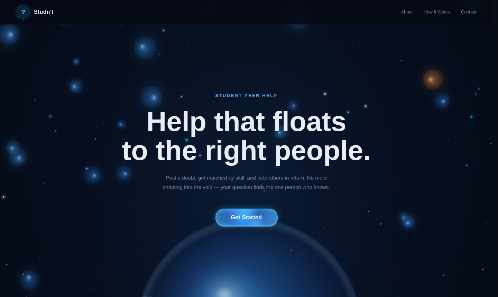
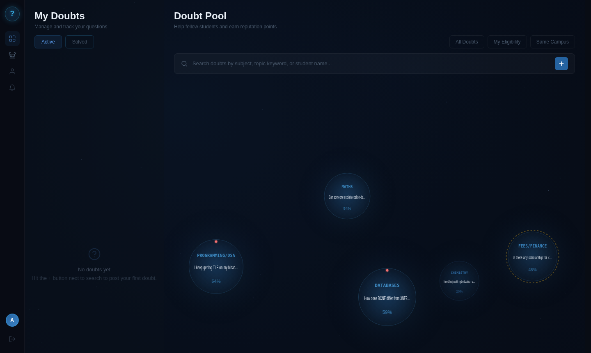
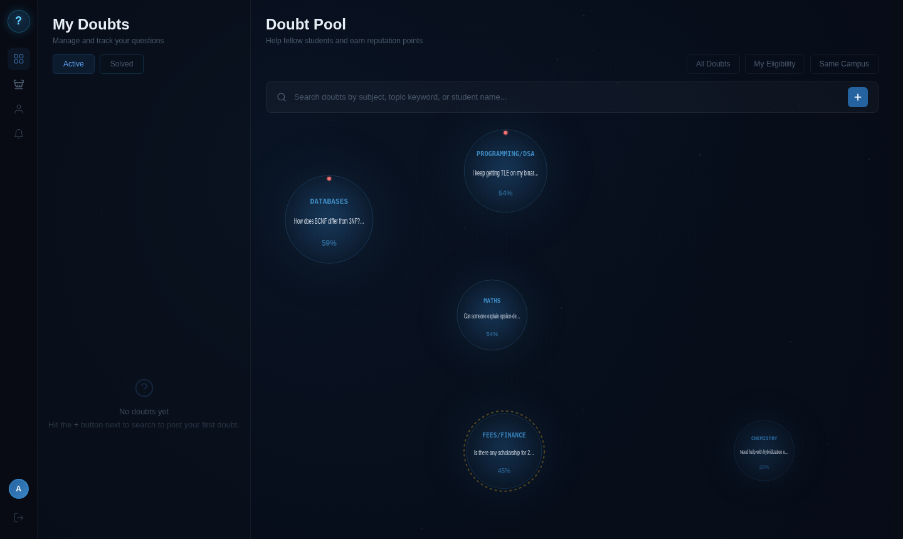
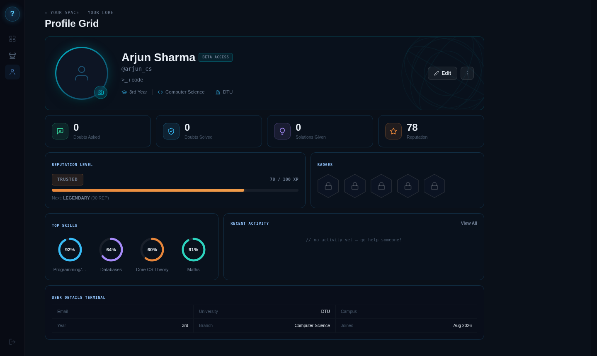
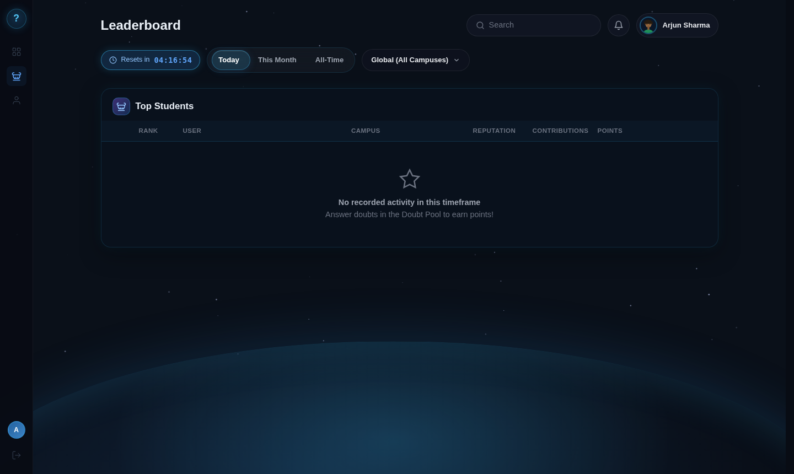
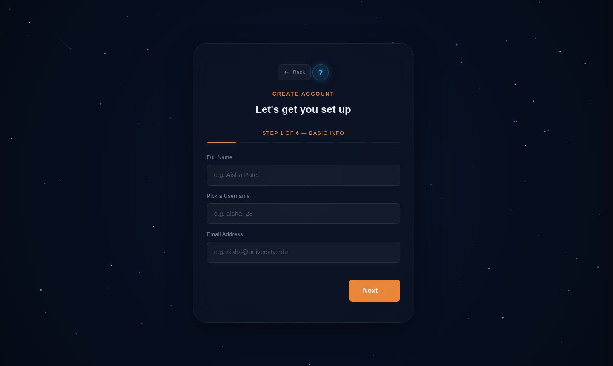
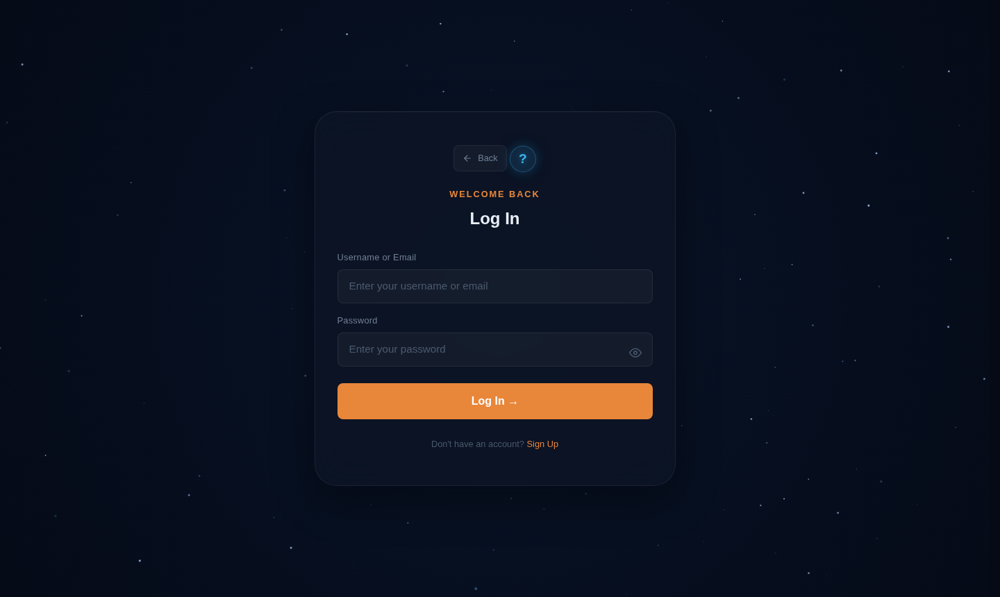

# Studn't — Peer Doubt Resolution Platform

> **Help that floats to the right people.**  
> Post a doubt, get matched by skill, and help others in return. No more shouting into the void — your question finds the one person who knows.

[](#tech-stack)
[](#tech-stack)
[](#)

---

## Screenshots

### Landing Page


### Dashboard — Live Doubt Pool

> Doubts float as bubbles — bigger means higher urgency, brighter glow means stronger skill match with you.

### Post a Doubt


### Notifications


### Profile


### Leaderboard


### Sign Up


### Login


---

## The Problem

Students have no structured peer channel for getting help:

| Channel | Problem |
|---|---|
| WhatsApp / Telegram | Doubts drown in noisy group chats. No structure, no tracking. |
| Stack Overflow / Quora | Generic answers — not your professor, not your syllabus. |
| Office Hours | Fixed slots, long queues — urgency and availability never align. |

**Studn't** solves this with skill-based matching, urgency ranking, and a reputation system that rewards consistent helpers.

---

## Features

- **Live Bubble Pool** — Open doubts render as physics bubbles on a canvas. Bubble size = urgency. Glow intensity = how well the doubt matches your skills.
- **Skill-Based Matching** — Declare your academic and non-academic skills at signup. Only relevant doubts are shown to you (≥ 60% match threshold).
- **Post a Doubt** — Set urgency (0–100 slider), add subject tags, and optionally specify a course + professor for exam-related doubts.
- **Claim & Answer** — Claim any doubt you can help with. Reply through a threaded answer system. The person who posted decides when it's resolved.
- **My Doubts Panel** — Three tabs: Active (doubts you posted), Claimed (doubts you're answering), Solved (resolved history).
- **Reputation System** — Decay-weighted score. Recent ratings move it meaningfully but one bad rating won't tank you. New users start at 50/100 — no cold-start penalty.
- **Leaderboard** — Daily / monthly / all-time rankings by reputation and contributions.
- **Notifications** — Real-time alerts for claims, replies, and resolutions.
- **Profile** — Skill rings, reputation level, badges, activity feed, and a terminal-style details panel.

---

## How It Works

```
Sign Up → declare skills (academic + non-academic)
    ↓
Dashboard → see open doubts as bubbles, ranked by urgency × match strength
    ↓
Click a bubble → read the full doubt, claim it if you can help
    ↓
Reply with your answer → doubt author marks it resolved
    ↓
Both parties rate each other → reputation updates
```

---

## The Algorithms

All three are **pure functions** — no DOM refs, no side effects. Paste into a Node REPL to test.

### `matchScore(doubt, user)` → `0..1`
Measures how well a doubt fits a user's declared skills.
- **Academic doubts** — tag overlap between doubt's subject tags and user's `academicSkills`.
- **Exam/logistics doubts with a `courseContext`** — exact `course + professor` string match scores significantly higher than a category-only match, because lived experience with that specific class is what actually helps.

### `priorityScore(doubt, candidateUsers, now)` → `number`
Ranks doubts in the pool. Combines:
- `w1 × helperAvailabilityWeight` — how many eligible helpers exist right now
- `w2 × matchStrength` — average match score across eligible helpers
- `w3 × waitTimeMinutes` — doubts waiting longer get a ranking boost

Tie-break: earlier `createdAt` wins on identical scores.

### `reputationScore(previousRep, recentRatings, decayFactor = 0.7)` → `number`
```
newRep = decayFactor × previousRep + (1 − decayFactor) × avgOfRecentRatings
```
- Decay factor `0.7` means recent ratings move the score meaningfully without whiplash.
- Seeds at `50` (neutral midpoint) — new users are never penalised just for being new.

---

## Tech Stack

| Layer | Tech |
|---|---|
| UI | Vanilla HTML / CSS / JavaScript (ES6 modules) |
| Backend | Node.js + Express REST API (`backend/`) |
| Database | MongoDB Atlas with Mongoose |
| Auth | bcrypt password hashing + JWT bearer tokens |
| API client | [`frontend/js/api.js`](frontend/js/api.js) — native `fetch()` wrapper |
| Canvas | `<canvas>` API — bubble physics + background animations |
| Routing | Multi-page HTML — no SPA framework |
| Build | None — frontend is static, backend runs `node server.js` |

**Dependency rule:** [`frontend/js/api.js`](frontend/js/api.js) is the only module that calls the backend, and `store.js` is the only module that touches `localStorage`. Every other module goes through one of those two.

---

## Project Structure

```
/
├── frontend/                    Static site — HTML, CSS, JS
│   ├── index.html               Landing page
│   ├── signup.html              Multi-step skill questionnaire
│   ├── login.html               Login (JWT)
│   ├── dashboard.html           Main app — bubble pool + my doubts
│   ├── profile.html             Own profile + public view (?id=xxx)
│   ├── leaderboard.html         Reputation rankings
│   ├── assets/screenshots/      Product screenshots
│   ├── css/                     Design tokens, base, components, per-page
│   └── js/
│       ├── api.js               fetch() client — attaches JWT, the only file that talks to the API
│       ├── runtime-config.js    API_BASE_URL — change this when deploying
│       ├── store.js             localStorage abstraction (legacy client state)
│       ├── models.js            User/Doubt factory functions + validation
│       ├── categories.js        Fixed category taxonomy — single source of truth
│       ├── urgency.js           Urgency levels + priority factor
│       ├── bubbles.js           Canvas bubble physics + rendering
│       ├── cursor.js            Custom cursor + magnetic buttons
│       ├── loading.js           Animated loading screen
│       ├── transitions.js       Page transition system
│       ├── sphere-bg.js         Background 3D sphere animation
│       ├── algorithms/
│       │   ├── matchScore.js        Pure — doubt ↔ user skill fit
│       │   ├── priorityScore.js     Pure — doubt ranking in the pool
│       │   └── reputationScore.js    Pure — decay-weighted reputation
│       ├── services/
│       │   └── leaderboardService.js
│       └── pages/               landing, signup, login, dashboard, profile, leaderboard
│
├── backend/                     Express REST API
│   ├── server.js                Entry — CORS, routes, error handler
│   ├── config/db.js             Mongoose connection
│   ├── routes/                  auth, users, doubts, replies, events, notifications
│   ├── controllers/             Request handlers
│   ├── middleware/auth.js       JWT verification
│   ├── models/                  User, Doubt, Reply, Notification, ContributionEvent
│   ├── scripts/verify-project.js
│   └── .env.example             Copy to .env and fill in — never commit .env
│
├── postman/                     Postman collection for API testing
├── render.yaml                  Render deploy blueprint
└── DEPLOYMENT_PHASE2.md         Local setup + Render deployment guide
```

---

## Getting Started

```bash
git clone https://github.com/Manveet07/Studn-t.git
cd Studn-t
```

### 1. Configure MongoDB Atlas

1. Create a MongoDB Atlas cluster and database user.
2. In Atlas Network Access, allow your current IP address (avoid `0.0.0.0/0` except for temporary testing).
3. Copy the Node.js connection string.
4. Create `backend/.env` by copying `backend/.env.example`.
5. Replace `MONGODB_URI` with your connection string — URL-encode special characters in the database username/password if needed — and set a long random `JWT_SECRET`.
6. Never commit `.env` or share your Atlas password publicly.

### 2. Start the backend

```bash
cd backend
npm install
npm run dev        # or: npm start
```

The API runs at `http://localhost:5000`. Check `http://localhost:5000/api/health`.

### 3. Start the frontend

Serve `frontend/` with VS Code Live Server (or any static server) — for example `http://127.0.0.1:5500`. Don't open the HTML as `file://`; ES module imports are blocked there.

The frontend's API base URL is `http://localhost:5000/api`, set in [`frontend/js/runtime-config.js`](frontend/js/runtime-config.js). Use Live Server on port `5500` unless you also change `FRONTEND_ORIGIN` in `backend/.env`.

---

## REST API Routes

| Method | Endpoint | Purpose | Auth |
|---|---|---|---|
| GET | `/api/health` | Check API server | No |
| POST | `/api/auth/register` | Create account | No |
| POST | `/api/auth/login` | Log in | No |
| GET | `/api/auth/me` | Current signed-in user | Yes |
| GET | `/api/users/leaderboard` | Leaderboard data | No |
| GET/PATCH | `/api/users/me` | Read/update own profile | Yes |
| GET/POST | `/api/doubts` | List/create doubts | POST requires auth |
| GET | `/api/doubts/:id` | Doubt and replies | No |
| PATCH | `/api/doubts/:id` | Edit own doubt | Yes |
| POST | `/api/doubts/:id/claim` | Claim an open doubt | Yes |
| POST | `/api/doubts/:id/replies` | Reply to a doubt | Yes |
| POST | `/api/doubts/:id/resolve` | Resolve own doubt | Yes |
| POST | `/api/doubts/:id/rating` | Rate the helper | Yes |
| POST | `/api/replies/:id/vote` | Like/dislike a reply | Yes |
| POST | `/api/replies/:id/best-answer` | Mark best answer | Yes |
| GET/POST | `/api/events/me`, `/api/events` | Contribution events | Yes |
| GET/POST | `/api/notifications` | List/create notifications | Yes |
| PATCH | `/api/notifications/:id/read`, `/api/notifications/read-all` | Mark read | Yes |

---

## Fetch Examples

### GET — load doubts

```js
const response = await fetch('http://localhost:5000/api/doubts');
const data = await response.json();

if (!response.ok) throw new Error(data.message || 'Could not load doubts');
console.log(data.doubts);
```

### POST — create a doubt

```js
const token = localStorage.getItem('studnt_token');

const response = await fetch('http://localhost:5000/api/doubts', {
  method: 'POST',
  headers: {
    'Content-Type': 'application/json',
    Authorization: `Bearer ${token}`
  },
  body: JSON.stringify({
    title: 'How does normalization work?',
    description: 'Can someone explain 2NF and 3NF with an example?',
    course: 'DBMS',
    category: 'academic',
    tags: ['DBMS'],
    urgency: 'medium'
  })
});

const data = await response.json();
if (!response.ok) throw new Error(data.message || 'Could not create doubt');
console.log(data.doubt);
```

[`frontend/js/api.js`](frontend/js/api.js) wraps `fetch`, attaches the saved JWT when available, and turns API errors into readable messages. Login, signup and the core doubt load/create/claim/resolve/reply actions are connected to the backend. Some legacy dashboard features (notification/reputation state and the older alternate dashboard pages) still have local-storage code and should be migrated endpoint-by-endpoint before production.

---

## Data Model

The client shape below maps onto the Mongoose models in `backend/models/`.

```js
// users
{
  id, name, username, university, year, branch,
  academicSkills,      // from categories.js taxonomy
  nonAcademicSkills,   // optional
  reputationScore,     // starts at 50, not 0
  ratingHistory,
  createdAt
}

// doubts
{
  id, authorId, category, tags, courseContext,
  description, urgency,  // 0–100 slider
  status,                // "open" | "claimed" | "resolved"
  claimedBy, createdAt, claimedAt, resolvedAt, ratingGiven
}
```

---

## Security Notes

- Passwords are hashed on the server; the API never returns the password hash.
- Keep the Atlas URI and JWT secret only in `backend/.env`.
- Configure Atlas Network Access narrowly.
- This is a development foundation. Before public deployment, add rate limiting, stronger input validation, production HTTPS, and review token storage/session strategy.

---

## Roadmap

| Phase | Status | Details |
|---|---|---|
| Phase 1 | ✅ Complete | Vanilla JS, LocalStorage, all core features |
| Phase 2 | 🚧 In progress | Express + MongoDB Atlas + JWT — auth, doubts, replies, events and notifications served by the API; remaining dashboard reads still migrating off localStorage |

See [DEPLOYMENT_PHASE2.md](DEPLOYMENT_PHASE2.md) for local setup, Render deployment, frontend `fetch()` configuration, MongoDB and Postman testing.

---

## Team

| Name | Branch | Contributions |
|---|---|---|
| **Manveet** | `Manveet` | Core architecture, landing page, dashboard UI, bug fixes |
| **Riya** | `riya` | Bubble pool polish, page transitions, mobile responsiveness |
| **Heer** | `heer` | Reply system, leaderboard, notification UI, profile styling |

---

## License

MIT — built for learning, feel free to fork and extend.
